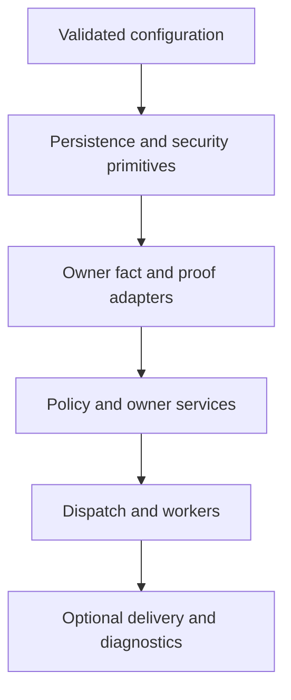

# Platform typed dependency graph

Direction: consumer → required provider. An asynchronous edge represents a durable handoff and completion obligation, not a synchronous startup wait. Conditional edges apply only to their actually registered target/action/purpose; they do not activate unsupported scopes. No whole upstream Module/Cluster maturity is inferred.

| Edge kind | Count |
|---|---:|
| ASYNC_COMMAND | 147 |
| ASYNC_EVENT | 109 |
| PROJECTION_COMMAND | 6 |
| PROJECTION_READ | 1 |
| PROVIDER_HANDOFF | 13 |
| RECOVERY_QUERY | 69 |
| SHARED_MECHANISM | 73 |
| SYNC_COMMAND | 42 |
| SYNC_QUERY | 368 |

828 typed edges; 132 permanent Shared Operations with unchanged owners/statuses; ten disabled facets. Explicit ports, commands, projections, provider handoffs and recovery queries are in [platform-dependency-graph.json](platform-dependency-graph.json). The 268 family mappings link into these edges without multiplying broad endpoint sets.

## Critical cycle dispositions

| Cycle | Concern | Disposition |
|---|---|---|
| CY-01 | Identity and Role bootstrap | Source credential/assignment facts are leaf queries; protected changes still require Role and bound assurance. No Track or recovery-locked session prerequisite for independent recovery evidence. |
| CY-02 | Role and protected owner facts | Internal fact purposes are narrowly registered, nonrecursive and field-scoped; user views remain fully authorized. No blanket service bypass. |
| CY-03 | Offering publication/readiness | Requirements, identity, relation and processing facts terminate; publication composes current readiness afterward. Digital/Video do not ask Marketplace to republish to answer facts. |
| CY-04 | Seller eligibility and source identity | Gig/Order/Offering source context and Professional identity are leaves; financial, verification and regulated decisions are action-specific. No generic ready flag or fake screening seller. Paid screening is a separate Order source under WA-R003: createChargeableOrder uses the authoritative Trust package quote and actual purchaser/subject relationship, not Professional seller readiness and not completion of the check being purchased. Trust initiates the paid check only after the source-bound Order qualification. evaluateVerificationReadiness reads existing requirement/evidence; it does not synchronously create a purchase or start a new check. Ordinary marketplace seller gates remain on their actual source/action, and acquired Order entitlement is evaluated separately from new-purchase seller eligibility. This terminates the initial paid-screening dependency without a fake seller or a free screening bypass. |
| CY-05 | Financial source/effect/refund | Order decision commits before Payment rail; provider actual effect commits before normalized Order result. Settlement facts do not execute money. Review refund through Order, Hold release no dispatch. |
| CY-06 | Purchased sessions and Booking | Pre-confirmation holds/slot facts break pay-confirm deadlock. Order reservation then Booking attachment receipt. Unknown stays reserved; fenced noncommit before release. |
| CY-07 | Enrollment and application quota | Profile commit precedes Track enrollment; quota intent reserve then Candidate commit then consume. Current period proof, no unknown release or delayed Free downgrade. |
| CY-08 | Job compliance source and publication | Source immutable input precedes check; current check precedes publication. No check/disclosure projection used as compensation source; complete scoped rescan. |
| CY-09 | Contextual file/playback access | Readiness/relationship facts terminate; contextual decision then credential issuance and durable proof. No signed-URL recursion; current exact version remains required. |
| CY-10 | Regulated provider and boundary evidence | Adapter configuration/capability and source ancestry are facts, never recursively dependent on Healthcare approval. Access/processing invokes approved coverage decision after facts. |
| CY-11 | Location and contextual source | Location source facts never call reveal; exact reveal current service/interview policy separate from public fuzz and tax; Search reads only SH-131 and cannot regenerate on read. |
| CY-12 | Privacy execution and projection/storage | Explicit generation inventory/instruction then owner completion receipts; actual bytes before ready; accepted work not completion; no erasure event cascade or self-declared backup purge. |
| CY-13 | Hold source release and business readiness | Evaluate original cause without requiring its own Hold absent; release one active revision; downstream rechecks every Hold and source restriction. Another cause never waived. |
| CY-14 | Moderation restriction/restoration and read models | Preserve authorized evidence before effect; action commit then typed owner receipt; restoration is new checked source effect, never Search-first restoration or Hold-release inference. |
| CY-15 | Notification/realtime and source outcomes | Source commit precedes safe intent; recipient facts read current source without source mutation. Delivery/telemetry cannot satisfy source or legal completion. |
| CY-16 | Audit protected read and telemetry | One authorization plus one durable nonrecursive receipt; append validates writer namespace. Diagnostics do not recursively require Audit/Notification/health before acceptance. |
| CY-17 | AI proposal and contextual classification | Provider output is proposal; source/Taxonomy revision validation precedes actual owner mutation receipt; AI acceptance follows receipt, not reciprocal accepted status prerequisites. |
| CY-18 | Reward qualification/effect/tax | Original owner fact qualifies once per rule; reserve then effect receipt; tax on actual recognized value. No reward-to-source completion, odds benefit or reverse Order prize dependency. |

## Startup dependency route

R086 defines integration stewardship. Callbacks register without constructor-time execution. Durable source/outbox commit survives unavailable delivery. Required action dependencies still fail closed; optional telemetry cannot prevent the primitive on which telemetry itself depends from starting. This is an architecture route, not a root build plan or production runner selection.

## Evidence limits

A module-level SCC includes all 34 owners; the reviewed synchronous action and startup projections have zero remaining cycles. The paid-screening branch is distinct from marketplace seller readiness. Fact and proof acceptance leaves authenticate their scoped callers and never re-enter the same composed gate. This static graph does not prove runtime call order, concurrency, transport schemas, provider cancellation or instant revocation. All remain qualification obligations.
